# 🚨 RoadSOS — Intelligent Accident Response System

### **National Road Safety Hackathon 2026**
**Team Name**: Team Harrington  
**Submission Date**: May 30, 2026  
**GitHub Repository**: [roadsaftey_harrington_iitm](https://github.com/Dakshin10/roadsaftey_harrington_iitm.git)  
**Project Report**: [📄 View PDF Report](https://drive.google.com/file/d/1UZ5nKYkousN-IexGkGN3vsnsHu6UynHM/view?usp=drivesdk)

---

## 📝 Abstract

RoadSOS is a comprehensive, dual-portal AI-powered autonomous accident detection and emergency response system. It consists of:
1. **The Mobile Application**: Carried by everyday riders and commuters, which utilizes on-device sensor fusion (accelerometer, gyroscope) to automatically detect collisions and transmit immediate distress coordinates.
2. **The Command Center Dashboard**: Monitored by police departments, medical response coordinators, and dedicated law enforcement teams to dispatch help, track active responders, and audit golden-hour response metrics.

Once an accident is detected by the user's mobile application, RoadSOS automatically triggers a failsafe alert that shares the victim’s live location and medical parameters with emergency contacts, nearby registered volunteers, and the police dispatch command center via WebSockets.

The primary goal of the system is to reduce emergency response delays during the critical **golden hour** (the first 60 minutes after impact) and improve survival rates through intelligent, zero-interaction emergency assistance.

---

## 💔 1. Problem Statement

Road accidents frequently leave victims unconscious or seriously injured, making it impossible for them to manually call for help.

Most existing emergency solutions depend on manual user interaction, such as:
- Pressing an SOS button
- Opening an emergency application
- Making a phone call

These approaches fail during severe accidents where victims cannot interact with their devices. Therefore, there is a need for an automated system capable of detecting accidents and initiating emergency response without requiring any user intervention.

---

## 💡 2. Proposed Solution

RoadSOS provides a fully automated emergency response mechanism that removes human dependency from the critical survival loop:
- **Automatic Detection**: Actively monitors physical forces using on-device mobile sensors.
- **Multi-Signal Verification**: Validates accident events through three-factor correlation before triggering alerts.
- **Safety Countdown**: Launches a local countdown overlay with text-to-speech warnings to prevent false alarms.
- **Failsafe Broadcast**: Automatically alerts registered emergency contacts and dispatches rescuers if the victim is unresponsive.
- **Live Telemetry & Tracking**: Shares live locations and paths in real time with responders.
- **Helper Crowdsourcing**: Notifies nearby volunteers dynamically using a geohash proximity network.

---

## 🏗️ 3. System Architecture & Main Components

The overall data flow follows a pipeline:
**Sensors** → **Detection Engine** → **Decision Engine** → **Alert System** → **Response Network**

### 3.1 Main Components

1. **Sensor Layer**: Continuously reads raw on-device metrics from the Accelerometer, Gyroscope, and GPS.
2. **Detection Engine**: Handles real-time signal analysis, noise filtration, and threshold calibrations.
3. **Emergency Decision Module**: Processes severity weights, coordinates the countdown, and handles cancellation events.
4. **SMS and Location Alert System**: Implements offline backup SMS alerts and online location updates.
5. **Nearby Helper Network**: Registers online volunteers, indexes location geohashes, and assigns nearby rescuers.
6. **Optional AI Severity Analysis Layer**: Incorporates computer vision and object detection models (YOLO) for post-impact camera assessment.

---

## ⚙️ 4. Accident Detection Logic

The system relies on multiple sensor signals. An emergency condition is triggered when:
1. **Sudden Impact**: High G-force deceleration spikes (exceeding dynamic thresholds).
2. **Abnormal Orientation**: Significant, sustained change in device orientation (indicating crash, roll, or slide).
3. **Victim Inactivity**: Absolute lack of motion for a predefined duration post-impact.

Using multiple correlated conditions reduces false positives and improves detection accuracy.

### 4.1 The Severity & Confidence Math
The severity of the impact is modeled using weighted sigmoid functions:

$$S_{\text{impact}} = \frac{1}{1 + e^{-1.5 \cdot (A_{\text{mag}} - 3.0)}}$$

$$S_{\text{orientation}} = \frac{1}{1 + e^{-1.0 \cdot (\Omega_{\text{mag}} - 4.0)}}$$

$$S_{\text{speed}} = \frac{1}{1 + e^{-0.1 \cdot (V_{\text{pre}} - 60.0)}}$$

$$S_{\text{inactivity}} = \min\left(\frac{T_{\text{inactive}}}{60.0}, 1.0\right)$$

The final Severity Score is computed as a weighted average of these factors:

$$\text{Score} = 0.40 \cdot S_{\text{impact}} + 0.25 \cdot S_{\text{orientation}} + 0.20 \cdot S_{\text{inactivity}} + 0.15 \cdot S_{\text{speed}}$$

- **CRITICAL** (Score $\ge 0.78$): High-speed collision, significant rotation, and complete inactivity.
- **HIGH** (Score $\ge 0.55$): Moderate-speed collision, abnormal post-impact orientation.
- **MEDIUM** (Score $\ge 0.30$): Low-speed crash or slide.
- **LOW** (Score $< 0.30$): Minor bump or drop.

---

## 🔄 5. Emergency Response Flow

1. **Accident Detected**: On-device sensor fusion flags a threshold breach.
2. **10-Second Countdown**: A fullscreen, blood-red alert overlay is displayed while the VoiceAlert TTS plays: *"Emergency detected. An accident alert is being sent. Tap Cancel if you are okay."*
3. **User Action**: The rider can tap **CANCEL EMERGENCY** within the 10-second window if it is a false alarm.
4. **Automatic Escalation**: If the countdown expires without user response:
   - SMS notifications are sent to emergency contacts.
   - The incident is stored in Firestore and broadcasted to the command center via Socket.IO.
   - A Geohash search is triggered to notify nearby online helpers.

---

## 🌟 6. Core Features

### 6.1 Automatic Accident Detection
Uses sensor fusion techniques (accelerometer and gyroscope data correlation) to identify accident events automatically.

### 6.2 Emergency SMS Alerts
Automatically informs emergency contacts with the victim's location, GPS coordinates, and a Google Maps link.

### 6.3 Live Location Tracking
Responders can track the victim’s location in real time via continuous WebSocket updates.

### 6.4 Nearby Help Network
Alerts nearby volunteer nodes within a predefined radius of the incident coordinates using geohash indexes.

### 6.5 False Alarm Prevention
Provides a cancellation countdown period before sending any emergency notifications.

---

## 📱 User Interfaces & Previews

RoadSOS incorporates two primary interfaces: the mobile application for riders and nearby volunteers, and the desktop web dashboard for the emergency command center police teams.

### 🚴 1. RoadSOS Mobile Application (For Commuters & Volunteers)
The mobile application is designed for everyday citizens, riders, and registered volunteers to automatically detect collisions and coordinate on-site helper response.

#### 1.1 Rider Experience & Telemetry
| Rider Mode (System Idle) | Rider Mode (Active Telemetry) | Settings & Preferences |
| :---: | :---: | :---: |
| 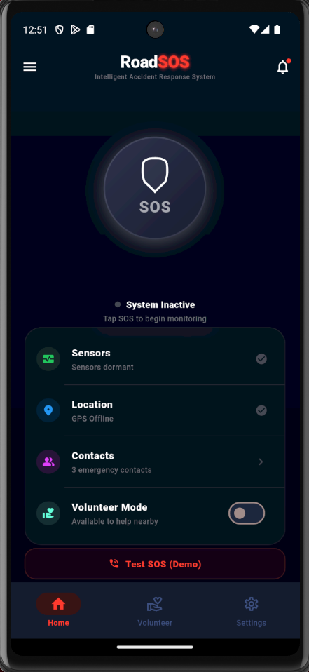 | 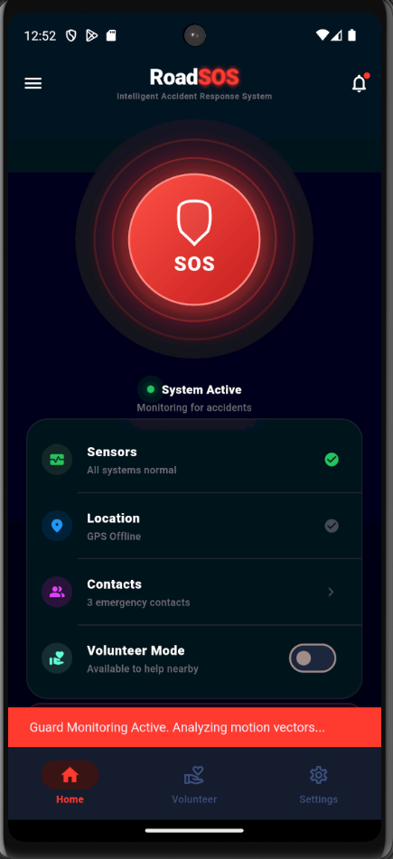 | 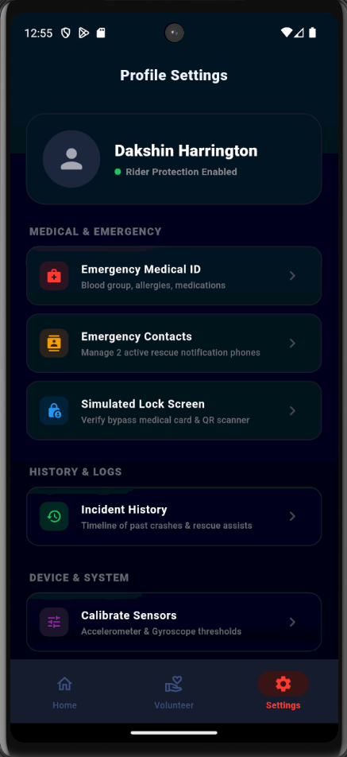 |
| System status monitoring is inactive. User can tap the main button to start monitoring. | Active ride telemetry showing real-time speed, GPS tracking, and active crash sensor monitoring. | Configure emergency contacts, sirens, detection sensitivity, and notification preferences. |

#### 1.2 Emergency Trigger Flow
| Accident Detected (10s Countdown) | Alert Sent (Help Dispatched) |
| :---: | :---: |
| 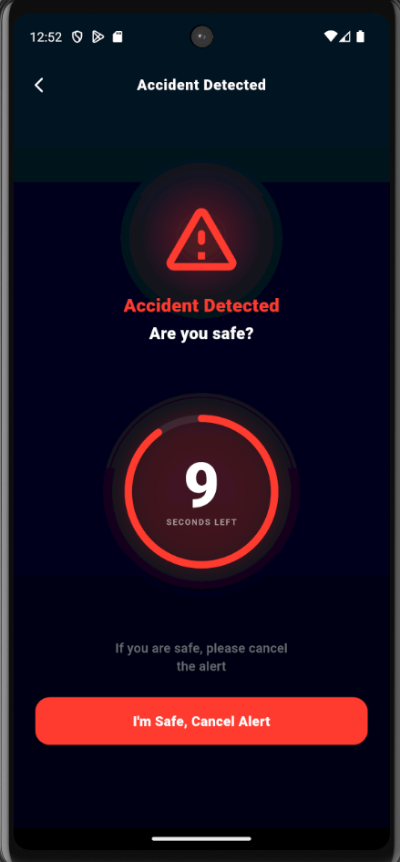 | 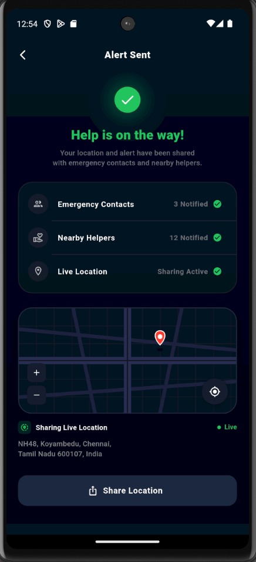 |
| Blood-red alert layout with a 10s countdown and text-to-speech feedback allowing user cancellation if safe. | Alert broadcast completed. Live location tracking is active and help is dispatched. |

#### 1.3 Volunteer Network & First Responder Tools
| Volunteer Dashboard | Medical ID Card | QR Code Access Panel |
| :---: | :---: | :---: |
| 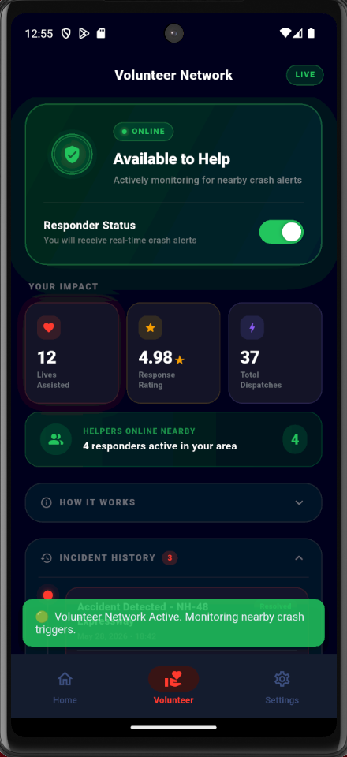 | 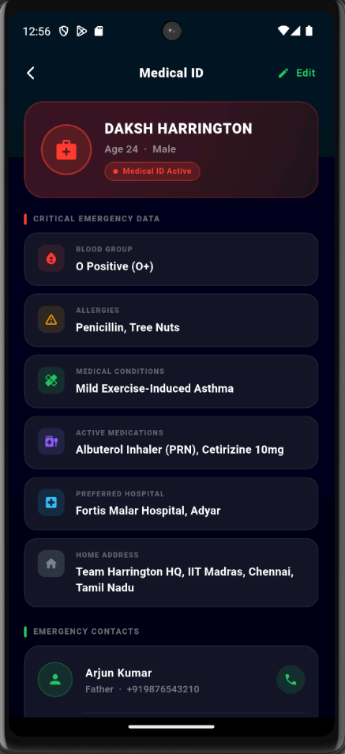 | 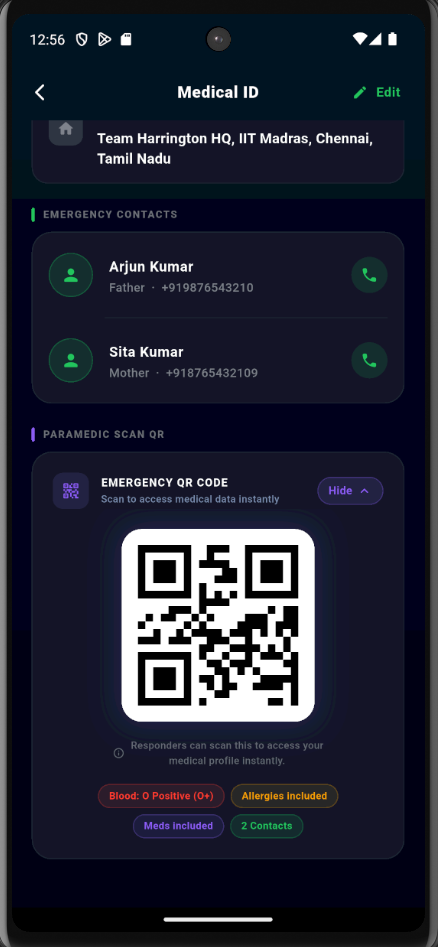 |
| Stats tracking, active volunteer status toggle, collapsible guides, and incident history timeline. | Displays blood group, allergies, medical conditions, and contacts directly to first responders. | Vector-painted offline QR code linking directly to the victim's secure emergency record. |

---

### 🖥️ 2. Police Command Center Dashboard (For Law Enforcement & Emergency Teams)
The web command center dashboard is monitored by police departments, dispatchers, and ambulance fleet managers to respond to critical emergencies.

#### 2.1 Live Incident Alerts Queue
| Live Alerts Console | Operations Tactical Map |
| :---: | :---: |
| 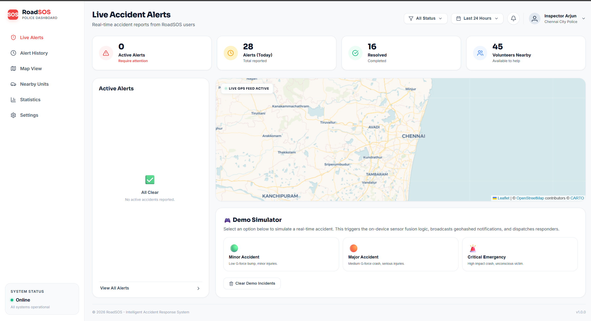 | 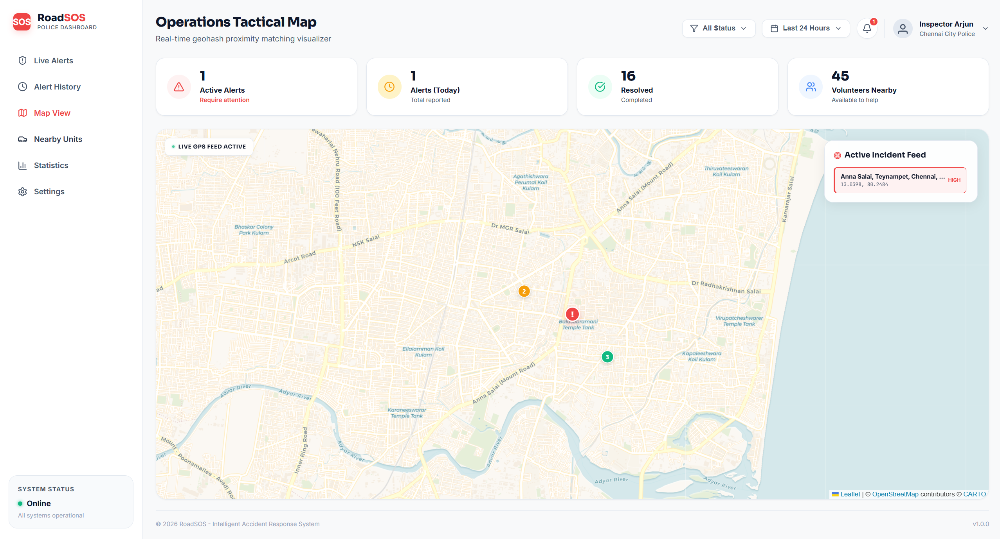 |
| Main dispatcher dashboard with real-time incident queue, live maps, and emergency command simulator. | Dedicated full-screen map highlighting accident locations, geohash coordinates, and volunteer locations. |

#### 2.2 Dispatch Fleet & Analytics
| Fleet & Responders Management | Analytics & SLA Auditor |
| :---: | :---: |
| 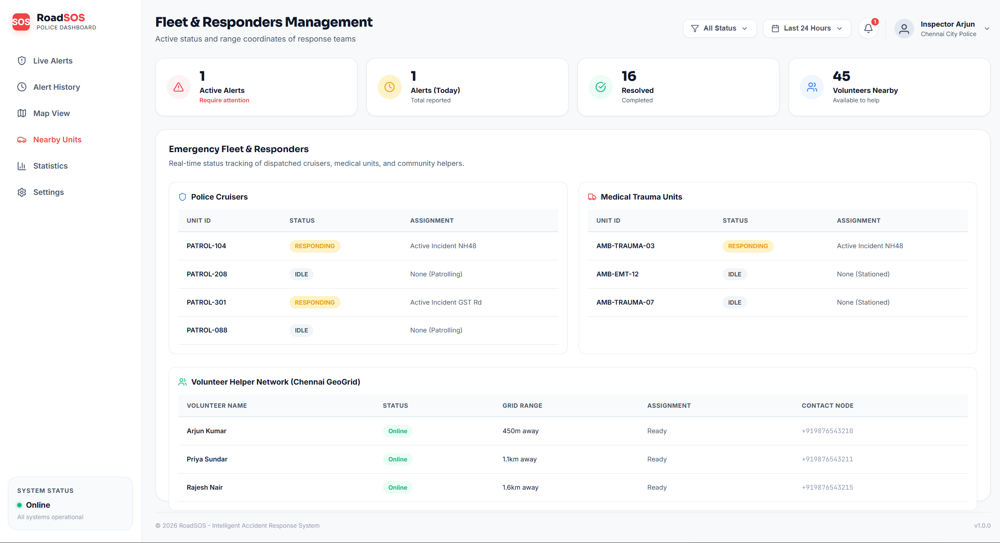 | 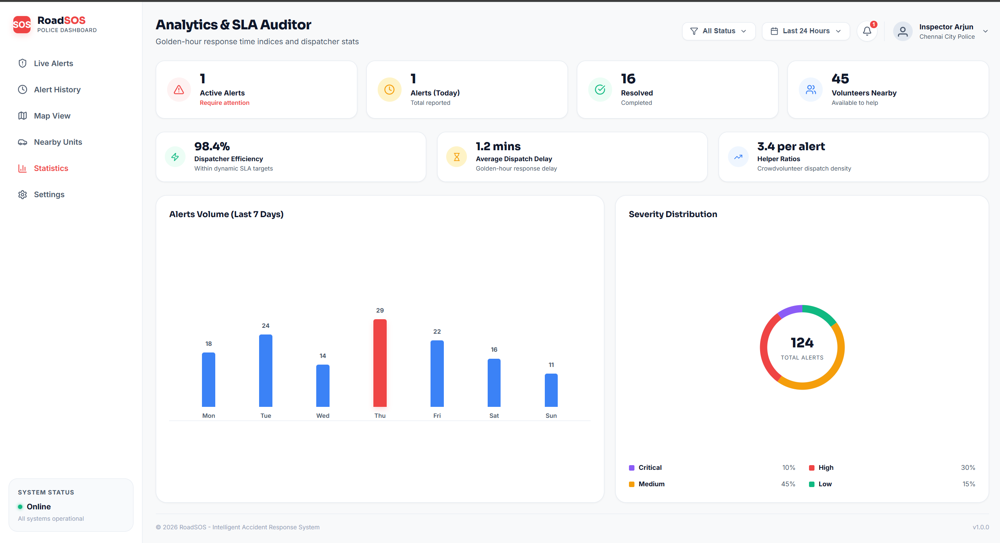 |
| Real-time responder tracking showing coordinates, status (responding/idle), and distance metrics. | Interactive data analytics dashboard tracking response SLA speeds, weekly incident rates, and status ratios. |

#### 2.3 Incident Logs & Configuration
| Incident History Logs Ledger | Command Center Settings |
| :---: | :---: |
| 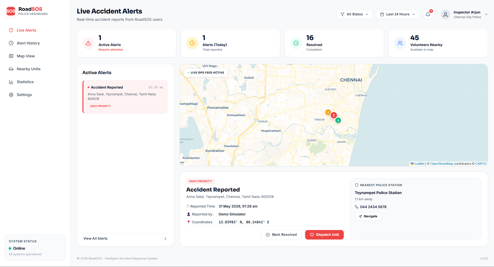 | 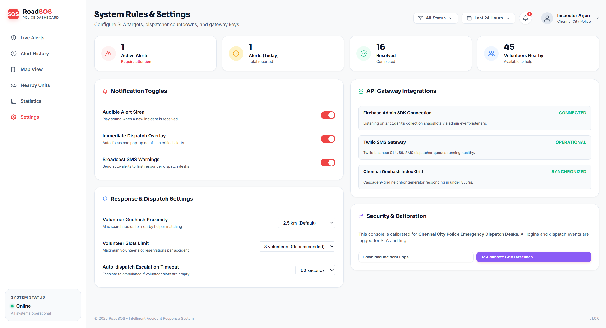 |
| Incident history ledger tracking all resolved accidents with inline dispatcher logs and timelines. | System configuration panel for SLA targets, API gateway credentials, and dispatch triggers. |

---

---

## 💻 7. Technology Stack

| Component | Technology Used |
| :--- | :--- |
| **Mobile Application** | Flutter (Dart) for Android and iOS targets |
| **Backend Services** | Flask with Flask-SocketIO |
| **Database** | Google Cloud Firestore |
| **Maps & Navigation** | OpenStreetMap / Google Maps API |
| **Artificial Intelligence** | scikit-learn Random Forest (implemented — advisory severity prediction) · YOLO (Future Scope for visual severity checks) |
| **Location Services** | Geolocator APIs / Android Location Services |
| **Messaging** | Twilio SMS API / Android SMS Manager APIs |

---

## 📦 8. Software Packages Used

### 8.1 Android & Mobile (Flutter)
- **firebase_core & cloud_firestore**: Cloud database synchronization.
- **sensors_plus**: Live accelerometer and gyroscope access.
- **geolocator**: High-precision GPS updates.
- **flutter_tts**: Real-time VoiceAlert speech synthesis.
- **socket_io_client**: Bi-directional event communication.
- **url_launcher**: Deep linking maps for responder navigation.

### 8.2 Backend
- **Flask & Flask-SocketIO**: WebSocket event loops and APIs.
- **NumPy**: Data parsing and math computations.
- **OpenCV & Ultralytics YOLO**: Computer vision modeling (Future Scope).
- **firebase-admin**: Secure Firestore transactions.

---

## 📡 9. Real-Time Communications (Socket.IO Specs)

The real-time synchronization is built entirely on WebSockets. Below is the event schema:

| Event Name | Direction | Sender | Payload Schema | Description |
| :--- | :--- | :---: | :--- | :--- |
| `create_incident` | Inbound | Flutter | `{ latitude: float, longitude: float, confidence: float, severity: string, severityScore: float, plusCode: string }` | Registers a new accident. |
| `update_location` | Inbound | Flutter | `{ incidentId: string, latitude: float, longitude: float }` | Broadcasts the victim's live coordinates. |
| `dispatch_resource` | Inbound | React | `{ incidentId: string, type: 'ambulance'\|'police' }` | Dispatches emergency services. |
| `update_status` | Inbound | React | `{ incidentId: string, status: 'RESPONDING'\|'RESOLVED' }` | Transitions the state of the incident. |
| `helper_respond` | Inbound | Flutter | `{ incidentId: string, helperUid: string, accepted: bool, distanceMeters: float }` | Records a volunteer's response. |
| `incident_created` | Outbound | Flask | Full Incident JSON | Broadcasts a new accident to the dashboard. |
| `incident_updated` | Outbound | Flask | Updated Incident fields JSON | Broadcasts updates (such as coordinates or dispatch status). |
| `helper_accepted` | Outbound | Flask | `{ incidentId: string, helperUid: string, slotsFilled: int }` | Confirms volunteer slot updates. |

---

## 🗺️ 10. Helper Network (9-Grid Geohash Cascade)

To maintain database efficiency, RoadSOS queries volunteers using **Geohashes** rather than scanning raw coordinates.

1. **Precision Toggling**: The search engine uses a 6-character Geohash prefix for search radii $\le 1.5\text{km}$ (covering a $1.2\text{km} \times 0.6\text{km}$ cell). For larger searches, it scales to a 5-character prefix ($4.9\text{km} \times 4.9\text{km}$ cell).
2. **Jitter Offset Neighbor Generation**: The backend generates 8 coordinates shifted in each compass direction by the cell dimensions. It encodes these shifted coordinates into Geohashes to find the surrounding cells.
3. **Database Prefix Query**: Firestore performs prefix matching on these 9 cells:
   ```python
   db.collection('helpers').where('status', '==', 'ONLINE') \
                           .where('geohash', '>=', prefix) \
                           .where('geohash', '<=', prefix + '\uf8ff')
   ```
4. **Distance Filtering**: The backend filters the results by calculating the exact Haversine distance from the center, sorting by proximity, and returning available volunteers.

---

## 🗄️ 11. Database Design (Firestore)

### 11.1 `incidents`
```json
{
  "latitude": 12.9716,
  "longitude": 77.5946,
  "victimLat": 12.9718,
  "victimLng": 77.5948,
  "timestamp": "2026-05-30T14:00:00Z",
  "status": "ACTIVE", // ACTIVE | RESPONDING | RESOLVED
  "source": "mobile", // mobile | demo
  "trackingActive": true,
  "confidence": 0.88,
  "severity": "CRITICAL", // LOW | MEDIUM | HIGH | CRITICAL
  "severityScore": 0.812,
  "plusCode": "7J4VXQCG+Q4",
  "helperSlots": 1,
  "helperRequestOpen": true,
  "acceptedHelpers": [
    {
      "uid": "helper_101",
      "name": "Arjun Kumar",
      "phone": "+919876543210",
      "acceptedAt": "2026-05-30T14:01:10Z",
      "distanceMeters": 450.2
    }
  ],
  "dispatchedResources": [
    {
      "type": "ambulance",
      "dispatchedAt": "2026-05-30T14:02:15Z"
    }
  ]
}
```

### 11.2 `helpers`
```json
{
  "uid": "helper_101",
  "name": "Arjun Kumar",
  "phone": "+919876543210",
  "status": "BUSY", // ONLINE | OFFLINE | BUSY
  "latitude": 12.9720,
  "longitude": 77.5930,
  "geohash": "tdr1v7mqu",
  "reputationScore": 4.85,
  "activeMissionId": "mission_incident_100_helper_101",
  "fcmToken": "fcm_token_string_here",
  "updatedAt": "2026-05-30T14:00:30Z"
}
```

### 11.3 `missions`
```json
{
  "id": "mission_incident_100_helper_101",
  "incidentId": "incident_100",
  "helperId": "helper_101",
  "helperName": "Arjun Kumar",
  "helperPhone": "+919876543210",
  "status": "EN_ROUTE", // ASSIGNED | EN_ROUTE | ON_SCENE | COMPLETED | ABANDONED
  "assignedAt": "2026-05-30T14:01:10Z",
  "updatedAt": "2026-05-30T14:01:30Z"
}
```

---

## 📌 12. Assumptions

1. **Permissions**: Users grant high-accuracy GPS and location tracking permissions.
2. **Setup**: Users configure valid emergency contact details prior to riding.
3. **Sensors**: Device sensors (accelerometer, gyroscope) operate normally and are not damaged.
4. **Failsafe**: The smartphone remains functional and connected to cellular networks (or SMS) post-impact.
5. **Network Connectivity**: Network access is available for live tracking and Firestore syncing.

---

## 🔒 13. Privacy and Safety

RoadSOS prioritizes user privacy:
- **Minimal Tracking**: Live location is shared only after an active incident is confirmed.
- **Opt-In Network**: Bystander alerts and volunteer notifications are entirely opt-in.
- **Anonymity**: No personal identity details are publicly exposed to the volunteer network.
- **Consented Capture**: Device camera capture is used only with explicit user consent.

---

## 🚀 14. Innovation and Differentiation

- **Zero-Touch Response**: Works fully autonomously even if the rider is unconscious.
- **Signal Correlation**: Mitigates false positives through triple-sensor verification.
- **Community Cascading**: Crowd rescue geohash system alerts closest helpers within seconds.
- **Adaptive Calibrator**: Calibrates on-device sensor baselines to adjust for varying motorcycle vibrations.

---

## ⚠️ 15. Limitations

- **Calibration Requirements**: Sensor baseline thresholds vary across different device hardware.
- **Rare False Positives**: Unique extreme drops or sports maneuvers could trigger warnings.
- **Device Destruction**: Complete hardware destruction upon high-impact crashes prevents data transmission.
- **Battery Demands**: Continuous sensor queries require optimized background thread processing.

---

## 🔮 16. Future Scope

- **Hospital & Trauma Integration**: Share victim severity details with nearby hospital trauma teams.
- **Police Command Integration**: Connect alerts directly to city police emergency dispatch desks.
- **Government Safety Deployments**: Integrate with highway safety cameras and emergency vehicles.
- **AI Severity Estimation**: Leverage YOLO models on the device to analyze crash aftermath via camera feeds.
- **Offline Mesh Network**: Leverage offline mesh networking to bridge gaps in areas with poor cellular coverage.

---

## 📂 17. Repository Structure

```
roadsaftey_harrington_iitm/
|-- app/                    # Flutter Mobile Client (incl. Severity Predictor screen)
|-- backend/                # Flask WebSocket Server
|   |-- ml/                 # Advisory ML module (loader, schema, predictor, rate limiter)
|   |-- routes/             # Blueprints (health, incident, dispatch, helper, demo, predictions)
|   |-- scripts/            # download_model.py / verify_model.py / build_feature_schema.py
|   |-- tests/              # pytest suite (60 tests, incl. a real-model run)
|   `-- requirements-ml.txt # ML runtime pins (scikit-learn 1.6.1, pandas, joblib, pytest)
|-- frontend_dashboard/     # React command-centre dashboard (CRA)
|   `-- src/components/SeverityPredictionPanel.jsx
|-- docs/                   # architecture, api, ml-model, testing, security, deployment…
|-- models/                 # downloaded model artifact (gitignored — never committed)
|-- assets/                 # Graphics & Static Resources
|-- README.md               # Main Documentation
`-- requirements.txt        # Backend python dependencies
```

---

## 🚀 18. Installation & Running Locally

### 18.1 Backend Command Center (Flask)
1. Navigate to the directory:
   ```bash
   cd backend
   ```
2. Place your service account key JSON as `serviceAccountKey.json` in the directory.
   *(Optional — without it Firestore features degrade gracefully; everything else runs.)*
3. Install dependencies:
   ```bash
   pip install -r requirements.txt -r requirements-ml.txt
   ```
4. Download the severity model (~1.97 GB, gitignored; size + SHA-256 verified):
   ```bash
   python scripts/download_model.py
   python scripts/verify_model.py --load     # optional smoke test
   ```
5. *(Optional)* configure: `copy .env.example .env` — CORS origins, API key,
   rate limit, model path. The file is read automatically; existing environment
   variables always win.
6. Start the server:
   ```bash
   python app.py
   ```
*The Socket.IO server will start on `http://localhost:5000`.*
*Sanity check:* `GET http://127.0.0.1:5000/api/v1/model/health` → `"available": true`.

### 18.2 React Dashboard
1. Navigate to the directory:
   ```bash
   cd frontend_dashboard
   ```
2. Install dependencies:
   ```bash
   npm install
   ```
3. Start the application:
   ```bash
   npm start
   ```
*The dashboard will launch on `http://localhost:3000`.*

### 18.3 Flutter App
1. Navigate to the directory:
   ```bash
   cd app
   ```
2. Run package fetch:
   ```bash
   flutter pub get
   ```
3. Launch on an emulator or device:
   ```bash
   flutter run
   ```
   Point the severity-analysis screens at your backend when it is not the
   Android emulator's host:
   ```bash
   flutter run --dart-define=ROADSOS_BACKEND_URL=http://10.0.2.2:5000
   ```
   *(Android emulator → `10.0.2.2`, iOS simulator/desktop → `127.0.0.1`,
   physical device → `http://<your-LAN-IP>:5000`.)*

Full run book, environment variables and production notes: [`docs/deployment.md`](docs/deployment.md).

### 18.4 Test everything (expected results in [`docs/testing.md`](docs/testing.md))

```powershell
cd backend      ; python -m pytest                                  # 60 passed
cd ../frontend_dashboard
npx eslint src --ext .js,.jsx                                       # 0 errors
npm run build                                                       # exit 0
$env:CI='true'; npx react-scripts test --watchAll=false             # 8 passed
cd ../app
flutter analyze --no-pub                                            # 0 errors
flutter test                                                        # 7 passed, 5 skipped
# with the backend running — real HTTP against the real model:
flutter test test/live_backend_e2e_test.dart --dart-define=ROADSOS_LIVE_E2E=true
```

### 📚 Documentation index

| Doc | Contents |
| :--- | :--- |
| [`docs/presentation-requirements.md`](docs/presentation-requirements.md) | What the slides ask for, mapped to the code (deviations D1–D5) |
| [`docs/architecture.md`](docs/architecture.md) | How the ML module, routes, dashboard and app fit together |
| [`docs/ml-model.md`](docs/ml-model.md) | Model provenance, feature contract, limitations |
| [`docs/api.md`](docs/api.md) | REST + socket contract, error codes, examples |
| [`docs/testing.md`](docs/testing.md) | PASS/FAIL/BLOCKED/NOT RUN report with evidence |
| [`docs/security.md`](docs/security.md) | Audit findings, fixes, production checklist |
| [`docs/deployment.md`](docs/deployment.md) | Step-by-step run book |

---

## 🤖 19. Advisory ML Severity Analysis (Random Forest)

A **real, published** machine-learning model is integrated end-to-end: it
estimates the *historical* severity class of an accident
(**Slight / Serious / Fatal**) together with the model's vote distribution,
from 14 structured attributes. This is a planning/after-the-fact estimate —
**not** crash detection, **not** a medical assessment, and **not** part of any
dispatch or countdown decision.

### 19.1 Model facts (verified in this repository)

| Property | Value |
| :--- | :--- |
| Source | Hugging Face `hayamwahdan/road-accident-severity-prediction`, pinned revision `c4a7daf4…53c` |
| Artifact | `road_accident_model.pkl` — 1,965,071,297 B, SHA-256 `B9E5BE7E…98B2` (both verified before use) |
| Algorithm | `RandomForestClassifier` — 100 trees, `gini`, `max_features=sqrt`, `random_state=42` |
| Input → encoded | 14 raw fields (5 numeric + 9 categorical) → **61** one-hot columns (authoritative `n_features_in_`) |
| Output | `{severity, probabilities, classOrder, latencyMs}` — class order `Fatal/Serious/Slight` |
| Runtime | load ≈ **10–14 s** at startup (warm cache), inference ≈ **9–30 ms** warm |
| Training env | scikit-learn **1.6.1** (pinned identically in `requirements-ml.txt`) |
| Publisher-reported accuracy | 80.03 % (SMOTE) / 85.4 % (baseline) — **quoted as unverified**, never re-claimed by us |

### 19.2 Where it appears

| Surface | Location |
| :--- | :--- |
| Mobile app | Profile → *Analytics (optional)* → **Severity Predictor** (`app/lib/ui/screens/severity_prediction_screen.dart`) |
| Dashboard | Incident detail → **Severity analysis** panel, including live `severity_prediction` socket updates |
| REST | `GET /api/v1/model/health` · `GET /api/v1/predictions/schema` · `POST /api/v1/predictions/severity` · `POST /api/v1/incidents/<id>/severity-prediction` — full contract in [`docs/api.md`](docs/api.md) |

Both clients build their forms from `/predictions/schema` (categories, allowed
speed limits, numeric ranges are never hard-coded), and both enforce the
published ranges before sending.

### 19.3 Safety rules (tested, not aspirational)

1. **Never blocks an emergency.** The module warms up non-fatally; if the model
   is missing or corrupt the endpoints answer `503 MODEL_UNAVAILABLE` while
   `/health`, `/incidents` and `/dispatch` keep returning `200` — verified live
   even while predictions were being rate-limited.
2. **Never mutates incident state.** Only the `severityPrediction` advisory
   field is written; `status`, dispatch and escalation are untouched
   (`backend/tests/test_safety.py`).
3. **Never replaces the sensor engine.** The Dart `SeverityEngine`
   (LOW/MEDIUM/HIGH/CRITICAL) and the legacy severity service are unchanged —
   the RF model is an *additional, separate* capability.
4. **Always labelled.** Every response carries a `limitations` array; both UIs
   show an "advisory estimate only" disclaimer.
5. **Fail-closed input validation.** Unknown keys, out-of-range numbers and
   unseen categories are rejected with field-scoped `400 INVALID_FEATURES`.

### 19.4 Known limitations

* Training data is British (mph limits, UK road/weather categories) — applying
  the model elsewhere is extrapolation (publisher recommends retraining).
* Probabilities are tree-vote fractions, not calibrated risks; driver behaviour
  and demographics are not modelled; no fairness/drift evaluation was performed.
* The YOLO post-impact camera assessment mentioned in the roadmap is **not** part
  of this integration (it remains future scope).

Details, provenance and configuration: [`docs/ml-model.md`](docs/ml-model.md).

### 19.5 Test results (all executed in this environment)

| Suite | Result |
| :--- | :--- |
| Backend `pytest` (incl. a real-model run) | **60 passed** |
| Dashboard lint / build / Jest | **0 errors** · build **exit 0** · **8/8 passed** |
| Flutter analyzer | **0 errors** (9 pre-existing warnings) |
| Flutter `flutter test` | **7 passed, 5 skipped** (opt-in live tests) |
| Flutter live end-to-end vs. running backend | **5/5 passed** |
| Live HTTP matrix (200/400/429/503, rate limit, emergency isolation) | all as documented |

Commands, evidence and the BLOCKED/NOT RUN list: [`docs/testing.md`](docs/testing.md).

---

## 📄 20. Conclusion

RoadSOS is a life-saving intelligent emergency response platform designed to bridge the gap between accident occurrence and emergency assistance.

By combining sensor-based accident detection, automated alerts, live location sharing, and community assistance, the system aims to significantly reduce emergency response times and improve survival outcomes during road accidents.

---
*Thank You*
